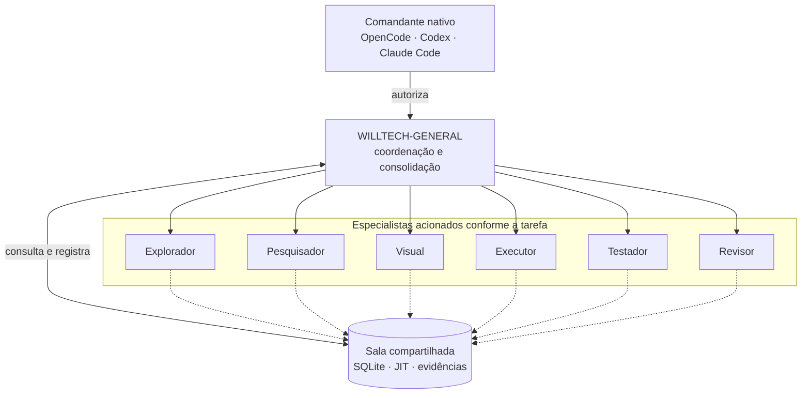

<!--
WILLTECH-GENERAL | PROJECT AUTHORSHIP
Copyright (c) 2026 WILLTECH-BH COMERCIO E SERVICOS LTDA
Project: WillTech-General
GitHub: https://github.com/hebwil/willtech-general
Maintainer: hebwil
Origin: WILLTECH custom multi-agent implementation
-->

<h1 align="center">WILLTECH-GENERAL</h1>

<p align="center">
  <strong>Orquestração multiagente com inteligência compartilhada, memória persistente e execução supervisionada</strong>
</p>

<p align="center">
  <strong>7 agentes · 3 plataformas · SQLite local · JIT adaptativo · Open source</strong>
</p>

<p align="center">
  <a href="https://github.com/hebwil/willtech-general/releases/tag/v3.1.2"><strong>Versão estável 3.1.2</strong></a> ·
  <a href="INSTALL.md">Instalação</a> ·
  <a href="docs/ARQUITETURA-3.0.md">Arquitetura</a> ·
  <a href="docs/RELEASE-NOTES-3.1.2.md">Novidades</a> ·
  <a href="LICENSE">MIT</a>
</p>

<p align="center">
  
</p>

## Inteligência coletiva para desenvolver com controle

O **WillTech-General**, desenvolvido pela **WILLTECH-BH**, reúne um coordenador (General) e seis especialistas em um sistema de orquestração para **OpenCode V2, OpenAI Codex e Claude Code**. Ele atua ao lado do agente principal da plataforma, sem substituir suas autorizações, ferramentas ou decisões.

A proposta é simples: o comandante define o objetivo; o General organiza o trabalho; os especialistas atuam somente quando necessário; e as descobertas relevantes podem ser preservadas na Sala compartilhada para reutilização entre sessões.

### O que o produto oferece

| Capacidade | Valor na prática |
|---|---|
| **Orquestração de sete agentes** | General coordena Explorador, Pesquisador, Visual, Executor, Testador e Revisor, com funções separadas e delegação seletiva. |
| **Shared Intelligence** | Sala SQLite projeto-local com proveniência, estado de validação e recuperação contextual entre sessões. |
| **Contexto sob demanda (JIT)** | Busca por objetivo e especialidade, priorizando registros validados sem despejar todo o histórico no contexto. |
| **Planejamento proporcional** | Tarefas diretas seguem fluxo curto; mudanças complexas recebem plano, critérios de aceite e revisão independente quando apropriado. |
| **RepoMap incremental** | Índice de símbolos e dependências atualizado por hash para evitar releituras desnecessárias. |
| **Supervisão e anti-loop** | Controle de repetição, delegações duplicadas, concorrência de escrita, tentativas e tempos limite com estados verificáveis. |
| **Automação nativa reversível** | Hooks e plugins por plataforma, instalação com consentimento, backup e remoção preservando componentes de terceiros. |
| **Segurança por contexto** | Dados externos tratados como dados, não comandos; proteção de segredos, isolamento de projeto e respeito às permissões do host. |

**Compatibilidade:** núcleo e distribuição para macOS, Linux e Windows nativo. Cada integração utiliza as capacidades próprias do OpenCode, Codex ou Claude Code; recursos de sandbox, hooks e interface podem variar conforme o runtime. No Windows nativo, use as instruções PowerShell do guia de instalação, não comandos de shell Unix.

---

## Como a arquitetura trabalha



O **General é um dos sete agentes**. A Sala é um serviço de conhecimento, não um oitavo agente. O comandante nativo continua responsável por consentimento, escopo e decisão final; o General não toma controle irrestrito do host.

### O General

<p align="center">
  <picture>
    <source media="(prefers-reduced-motion: reduce)" srcset="docs/assets/willtech-general-static.webp" type="image/webp">
    <source srcset="docs/assets/willtech-general-animated.apng" type="image/apng">
    
  </picture>
</p>

### Os seis especialistas

<table>
  <tr>
    <td align="center" width="33%">
      <br>
      <strong>Explorador</strong><br>
      <sub>Análise estrutural de código, dependências e reconhecimento de repositórios</sub>
    </td>
    <td align="center" width="33%">
      <br>
      <strong>Pesquisador</strong><br>
      <sub>Investigação técnica, bibliotecas, documentação e requisitos</sub>
    </td>
    <td align="center" width="33%">
      <br>
      <strong>Visual</strong><br>
      <sub>Engenharia de interfaces, UX, acessibilidade e análise visual</sub>
    </td>
  </tr>
  <tr>
    <td align="center">
      <br>
      <strong>Executor</strong><br>
      <sub>Implementação controlada de alterações autorizadas</sub>
    </td>
    <td align="center">
      <br>
      <strong>Testador</strong><br>
      <sub>Validação funcional, testes automatizados e investigação de falhas</sub>
    </td>
    <td align="center">
      <br>
      <strong>Revisor</strong><br>
      <sub>Revisão independente, qualidade, arquitetura e regressões</sub>
    </td>
  </tr>
</table>

As atribuições são complementares: o Explorador mapeia, o Pesquisador fundamenta, o Visual avalia experiências, o Executor implementa, o Testador verifica e o Revisor oferece análise independente.

---

## Comece a usar

**Requisitos:** Git, Python 3 e ao menos uma das plataformas suportadas. O núcleo usa Python e SQLite locais; eventuais custos de modelos dependem do provedor escolhido no host.

**1. Obtenha a versão oficial**

```sh
git clone https://github.com/hebwil/willtech-general.git
cd willtech-general
```

Para uma instalação reprodutível, escolha a [release v3.1.1](https://github.com/hebwil/willtech-general/releases/tag/v3.1.1) e siga o [guia de instalação por plataforma](INSTALL.md), que inclui os procedimentos de backup, registro dos sete agentes e configuração de permissões.

**2. Integre ao seu ambiente**

| Plataforma | Integração principal |
|---|---|
| **OpenCode V2** | Subagentes em `opencode/agent/`, política do comandante, wrappers e plugin V2; a delegação General → especialistas requer profundidade de subagentes configurada para 2. |
| **Codex** | Agentes TOML em `codex/agents/` e hooks projeto-local, sujeitos à autorização nativa do Codex. |
| **Claude Code** | Agentes em `claude-code/agents/` e hooks integrados ao mecanismo nativo da plataforma. |

**3. Ative a automação no projeto, se desejar**

Em macOS ou Linux, depois de configurar os agentes conforme o guia, o instalador de automação pode ser executado no projeto desejado com consentimento:

```sh
sh tools/willtech-install.sh --platform opencode
```

O exemplo seleciona OpenCode; consulte [INSTALL.md](INSTALL.md) para as alternativas Codex e Claude Code, Windows PowerShell, atualização, desativação e desinstalação. A automação é **projeto-local** e não deve sobrescrever configurações globais ou de terceiros.

**4. Delegue pelo comandante da plataforma**

> Analise a estrutura deste projeto com o WillTech-General. Delegue a exploração ao Explorador, use a Sala para recuperar decisões relevantes e peça revisão independente ao Revisor antes de propor alterações. Não modifique arquivos sem autorização.

---

## Memória compartilhada: a Sala dos Agentes

A **Sala** é um banco SQLite em `.willtech/room.db` que conecta descobertas, decisões, riscos e handoffs aos seus autores e às evidências de origem. Cada registro mantém contexto de projeto, status e, quando aplicável, hash de proveniência. Assim, conhecimento antigo ou contraditório não é tratado automaticamente como verdade atual.

Os hooks podem recuperar orientação validada ao iniciar uma sessão. Durante um trabalho, a consulta JIT busca somente informações relevantes ao objetivo e à especialidade. Registros candidatos permanecem identificados como não validados; micro-habilidades exigem promoção humana explícita.

**Operação local pelo terminal (na raiz do projeto):**

```sh
python3 tools/willtech-room.py init .willtech/room.db --repo .
python3 tools/willtech-room.py query .willtech/room.db --repo . --objective "estrutura do projeto" --specialty explorador
python3 tools/willtech-room.py check .willtech/room.db --repo .
```

Leia [Shared Intelligence](docs/SHARED-INTELLIGENCE.md) para os ciclos de vida dos registros, recuperação contextual, handoffs e micro-habilidades.

---

## Controles de engenharia e segurança

- **Permissões do host preservadas.** Uma negativa real, como `permission.rejected`, não é contornada nem reclassificada como sucesso.
- **Separação de responsabilidades.** O agente de implementação não substitui a revisão; o General não executa indiscriminadamente todas as especialidades.
- **Evidência e rastreabilidade.** Decisões e retornos de tarefas podem ser associados a hashes, estados e registros locais, sem guardar o conteúdo completo de arquivos sensíveis.
- **Defesa contra repetição e deriva.** O supervisor controla tentativas redundantes, concorrência e tempos limite; a recuperação de conhecimento respeita validação e escopo de projeto.
- **Instalação consciente.** Hooks e plugins são ativados por opção explícita, com registro de propriedade e caminhos de reversão descritos em [INSTALL.md](INSTALL.md).

**Nota de segurança:** os controles variam de acordo com a plataforma. O sandbox adicional dos wrappers do OpenCode utiliza `sandbox-exec` no macOS; em outros sistemas prevalecem as permissões disponíveis no host. Os arquivos TOML do Codex, por si, não fornecem isolamento forte por agente. Nenhum prompt substitui as proteções reais do runtime.

---

## Identidade visual e experiência

Os sete mascotes acompanham a arquitetura com estados de atividade como aguardando, executando, concluído e bloqueado. As animações são locais, têm opção de pausa e respeitam a preferência por movimento reduzido.

- **OpenCode Desktop:** painel visual opt-in, com suporte condicionado à interface GUI nativa e à versão compatível.
- **Claude Code:** mod visual com superfícies disponibilizadas pela plataforma.
- **Codex:** visualizador complementar separado; não é apresentado como painel nativo integrado ao IDE.

A interface visual é independente da lógica de orquestração: sua ativação não muda agentes, permissões ou decisões. Consulte [instalação](INSTALL.md) para habilitar a experiência adequada ao seu ambiente.

---

## Documentação e estrutura do projeto

| Guia | Conteúdo |
|---|---|
| [Instalação](INSTALL.md) | Passo a passo para cada host, sistemas operacionais, atualização e reversão. |
| [Arquitetura](docs/ARQUITETURA-3.0.md) | Topologia dos agentes, orquestração, memória, automação e fluxos de segurança. |
| [Shared Intelligence](docs/SHARED-INTELLIGENCE.md) | Sala SQLite, JIT, proveniência, estados, handoffs e micro-skills. |
| [Notas da v3.1.2](docs/RELEASE-NOTES-3.1.2.md) | Escopo e mudanças da versão publicada. |
| [Segurança e permissões](AUDITORIA.md) | Contratos de isolamento e limites técnicos das integrações. |
| [Histórico de evolução](EVOLUCAO.md) | Evolução funcional e decisões de engenharia. |
| [Autoria e avisos](NOTICE.md) | Identidade do projeto e componentes externos. |

```text
willtech-general/
├── opencode/       agentes, plugin V2, política e interface visual
├── codex/          agentes TOML, hooks e visualizador
├── claude-code/    agentes, hooks e integração com Claude Code
├── tools/          sala, supervisor, automação, RepoMap e distribuição
├── docs/           arquitetura, guias e recursos visuais
└── history/        histórico da arquitetura
```

---

## Desenvolvimento e licença

| | |
|---|---|
| **Projeto** | WillTech-General |
| **Desenvolvimento** | WILLTECH-BH |
| **Mantenedor** | [hebwil](https://github.com/hebwil) |
| **Repositório** | [github.com/hebwil/willtech-general](https://github.com/hebwil/willtech-general) |
| **Licença** | MIT |

O código e os arquivos próprios deste repositório são disponibilizados sob os termos da [Licença MIT](LICENSE), respeitadas as licenças aplicáveis a quaisquer componentes de terceiros.

---

## Créditos e referências

O WillTech-General é uma implementação personalizada da WILLTECH-BH. Os mecanismos de inteligência integrada são implementação própria, inspirados em conceitos públicos de projetos estudados — nenhum código foi copiado:

- [Microsoft TokenEconomizer](https://github.com/microsoft/TokenEconomizer) — conceitos adaptados: micro-skills (como lições verificadas por hash) e seleção econômica de ferramentas.
- [Google Elephant-Goldfish Model](https://github.com/google/elephant-goldfish-model) — conceito adaptado: revisão independente em contexto fresco, acionada seletivamente.
- [Multi-Agent Shogun](https://github.com/yohey-w/multi-agent-shogun), por [yohey-w](https://github.com/yohey-w) — referência de coordenação hierárquica de agentes.

O WillTech-General não é distribuição oficial desses projetos nem possui vínculo com seus mantenedores.

---

**WILLTECH-GENERAL — Engenharia multiagente com comando, especialização e evidências.**
