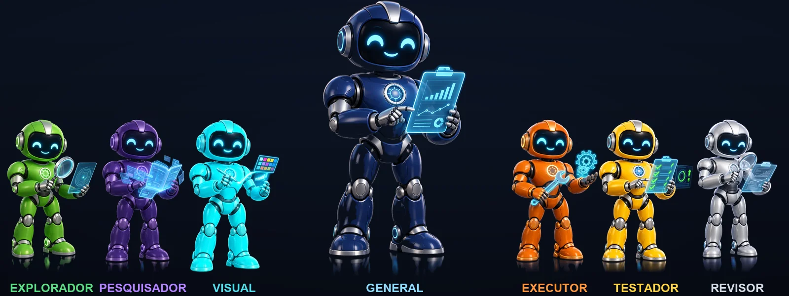
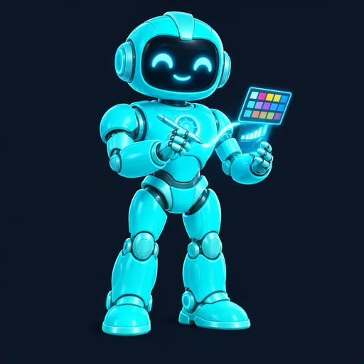

<!--
WILLTECH-GENERAL | PROJECT AUTHORSHIP
Copyright (c) 2026 WILLTECH-BH COMERCIO E SERVICOS LTDA
Project: WillTech-General
GitHub: https://github.com/hebwil/willtech-general
Maintainer: hebwil
Origin: WILLTECH custom multi-agent implementation
-->

<h1 align="center">WILLTECH-GENERAL</h1>

<p align="center">
  <strong>Orquestração Multiagente para Engenharia de Software</strong><br>
  <em>Uma arquitetura. Múltiplos especialistas. Um único comando.</em>
</p>

<p align="center">
  
</p>

---

O **WillTech-General** é uma arquitetura modular de orquestração de agentes de inteligência artificial, desenvolvida pela **WILLTECH-BH** para organizar, delegar e supervisionar tarefas complexas de engenharia de software.

Projetado para integrar-se ao **Claude Code, OpenCode e OpenAI Codex**, o projeto transforma agentes especializados em uma equipe coordenada, preservando o controle do agente principal de cada plataforma.

Em vez de substituir o assistente nativo por outro orquestrador, o WillTech-General acrescenta uma camada subordinada de coordenação, acionada quando a complexidade da tarefa justifica a delegação.

**Seu princípio central: delegar com propósito, executar com controle e concluir com evidências.**

---

## O conceito

O WillTech-General adota uma estrutura hierárquica de três níveis:

```text
               COMANDANTE NATIVO
           Claude Code | Codex | OpenCode
                       |
                       v
                WILLTECH-GENERAL
              Coordenação inteligente
                       |
        +--------------+--------------+
        |              |              |
        v              v              v
     ANÁLISE       IMPLEMENTAÇÃO    QUALIDADE
        |              |              |
   Explorador        Executor       Testador
   Pesquisador                       Revisor
   Visual
```

### Nível 1 — Comandante

O agente principal da plataforma permanece responsável pelas decisões, autorizações, escopo e entrega final.

### Nível 2 — WillTech-General

<p align="center">
  <picture>
    <source media="(prefers-reduced-motion: reduce)" srcset="docs/assets/willtech-general-static.webp" type="image/webp">
    <source srcset="docs/assets/willtech-general-animated.apng" type="image/apng">
    
  </picture>
</p>

O coordenador recebe tarefas complexas, identifica dependências, organiza etapas, seleciona especialistas, acompanha resultados e consolida evidências.

Não assume o controle da sessão nem substitui o comandante.

### Nível 3 — Especialistas

Seis agentes com responsabilidades específicas, utilizados conforme a natureza do trabalho.

A arquitetura prioriza delegação seletiva, evitando mobilizar toda a equipe para operações simples.

---

## Equipe especializada

<table>
  <tr>
    <td align="center" width="33%">
      <br>
      <strong>Explorador</strong><br>
      <sub>Análise estrutural de código, dependências e reconhecimento de repositórios</sub>
    </td>
    <td align="center" width="33%">
      <br>
      <strong>Pesquisador</strong><br>
      <sub>Investigação técnica, bibliotecas, documentação e requisitos</sub>
    </td>
    <td align="center" width="33%">
      <br>
      <strong>Visual</strong><br>
      <sub>Engenharia de interfaces, UX, acessibilidade e análise visual</sub>
    </td>
  </tr>
  <tr>
    <td align="center">
      <br>
      <strong>Executor</strong><br>
      <sub>Implementação controlada de alterações autorizadas</sub>
    </td>
    <td align="center">
      <br>
      <strong>Testador</strong><br>
      <sub>Validação funcional, testes automatizados e investigação de falhas</sub>
    </td>
    <td align="center">
      <br>
      <strong>Revisor</strong><br>
      <sub>Revisão independente, qualidade, arquitetura e regressões</sub>
    </td>
  </tr>
</table>

Cada agente possui um contrato operacional, com responsabilidades, limites e critérios de entrega.

O modelo de permissões depende das capacidades e configurações de cada runtime. As restrições precisam ser verificadas tecnicamente, não apenas declaradas nos prompts.

---

## Princípios de engenharia

### 01 — Comando preservado

O agente principal mantém a autoridade. O General coordena, mas não redefine unilateralmente os objetivos.

### 02 — Delegação proporcional

Tarefas simples permanecem com o comandante. Especialistas são acionados quando oferecem benefício concreto.

### 03 — Especialização funcional

Cada agente atua em uma responsabilidade delimitada, reduzindo sobreposição e retrabalho.

### 04 — Execução controlada

Mudanças devem respeitar o escopo autorizado, preservar o código existente e permitir inspeção dos resultados.

### 05 — Verificação independente

Quando necessário, a implementação é submetida a testes e revisão antes da conclusão.

### 06 — Evidências antes de conclusões

Uma tarefa não é considerada concluída apenas pela declaração de um agente. Resultados devem ser sustentados por arquivos, diffs, testes ou outras evidências verificáveis.

### 07 — Recuperação e continuidade

O fluxo prioriza reaproveitamento de trabalho existente, identificação de bloqueios e continuidade controlada, evitando reinícios desnecessários.

---

## Compatibilidade

O projeto mantém implementações específicas para diferentes ambientes de desenvolvimento assistido por IA.

| Plataforma | Implementação | Estado documentado |
|---|---|---|
| **OpenAI Codex** | Agentes nativos em TOML | Delegação hierárquica validada |
| **OpenCode V2** | Subagentes Markdown | Delegação aninhada validada |
| **Claude Code** | Subagentes Markdown | Pacote disponível; instalação e delegação ainda não homologadas no ambiente atual |

A estrutura conceitual é compartilhada, mas os mecanismos de delegação, execução e controle de permissões variam entre plataformas.

### Integração sem substituição

O WillTech-General foi concebido para trabalhar com o agente principal existente, sem exigir que outro framework assuma o comando.

As variantes são mantidas separadamente para respeitar as capacidades nativas de cada plataforma.

---

## Estrutura do projeto

```text
willtech-general/
├── claude-code/
│   ├── agents/
│   ├── bin/
│   └── INSTALAR.command
│
├── codex/
│   └── agents/
│
├── opencode/
│   ├── agent/
│   ├── bin/
│   ├── tests/
│   ├── AGENTS.md
│   └── HOMOLOGACAO.md
│
├── docs/
│   └── assets/
│
├── history/
│
├── README.md
├── INSTALL.md
├── HISTORICO.md
├── AUDITORIA.md
├── NOTICE.md
└── LICENSE
```

- **claude-code/** — implementação, ferramentas de instalação e arnês de homologação para Claude Code.
- **codex/** — agentes adaptados ao runtime Codex nativo.
- **opencode/** — agentes, wrappers de shell com sandbox, política do comandante
  e testes de regressão para OpenCode V2.
- **history/** — preservação de versões históricas da arquitetura.
- **docs/assets/** — identidade visual da equipe: cards e banner em WebP, animação do General em APNG/GIF com fallback estático e respeito a `prefers-reduced-motion`.
- **AUDITORIA.md** — testes, evidências e limitações técnicas documentadas.

Consulte [INSTALL.md](INSTALL.md) para os procedimentos de instalação específicos de cada plataforma.

---

## Segurança e limitações

O WillTech-General foi concebido com separação de responsabilidades, proteção do escopo autorizado e revisão de resultados.

Entretanto, **instruções de agentes não constituem, por si só, isolamento de segurança**.

Operações por shell, ferramentas externas e mecanismos de delegação podem exigir políticas adicionais para impedir escrita ou execução não autorizada.

A proteção efetiva deve ser avaliada conforme o runtime utilizado. Os resultados conhecidos, suas limitações e testes de homologação estão documentados em [AUDITORIA.md](AUDITORIA.md).

### OpenCode 2.2.6 — isolamento aplicado

No OpenCode, as permissões são ordenadas e a **última regra que casa vence**. Os
agentes de leitura negam explicitamente `shell`, `edit`, `subagent`, `execute` e
as ferramentas nativas `opencode_worktree_create`/`opencode_worktree_remove`.

Shell é liberado apenas pelos wrappers:

```sh
~/.config/opencode/bin/willtech-read-shell "COMANDO"
~/.config/opencode/bin/willtech-test-shell "COMANDO"
```

O comando deve ir **inteiro entre aspas duplas**. Sem aspas, o runtime nega a
chamada; isso impede que `>`, `;`, `&&` e `|` sejam executados fora do sandbox.
O wrapper de leitura bloqueia escrita; o de teste confina escrita a
`~/willtech-lab`, bloqueia rede, SSH, `.env` e configurações sensíveis.

Matriz completa e limites em [opencode/HOMOLOGACAO.md](opencode/HOMOLOGACAO.md).
Regressão sem custo de modelo: `sh opencode/tests/test-wrappers.sh`.

### Limitações por plataforma

| Plataforma | Isolamento real | Estado |
|---|---|---|
| **OpenCode 2.2.6** | Por agente, aplicado pelo runtime + sandbox dos wrappers | Homologado nos testes documentados |
| **Codex** | Instrucional; o TOML não oferece permissão por agente | Sem garantia equivalente |
| **Claude Code** | Depende dos controles do runtime e do pacote | Não homologado nesta máquina |

---

## Filosofia do projeto

**Mais agentes não significam necessariamente mais inteligência.**

A eficiência de um sistema multiagente depende de como o trabalho é dividido, do momento em que a delegação acontece e da qualidade das evidências produzidas.

O WillTech-General busca uma arquitetura enxuta, supervisionável e extensível, na qual cada especialista tenha uma função clara e o agente principal mantenha o controle.

O objetivo não é automatizar indiscriminadamente. É oferecer uma estrutura de engenharia capaz de lidar com tarefas complexas de maneira organizada, verificável e consistente.

---

## Desenvolvimento e licença

| | |
|---|---|
| **Projeto** | WillTech-General |
| **Desenvolvimento** | WILLTECH-BH |
| **Mantenedor** | [hebwil](https://github.com/hebwil) |
| **Repositório** | [github.com/hebwil/willtech-general](https://github.com/hebwil/willtech-general) |
| **Licença** | MIT |

O código e os arquivos próprios deste repositório são disponibilizados sob os termos da [Licença MIT](LICENSE), respeitadas as licenças aplicáveis a quaisquer componentes de terceiros.


---

**WILLTECH-GENERAL — Engenharia multiagente com comando, especialização e evidências.**
